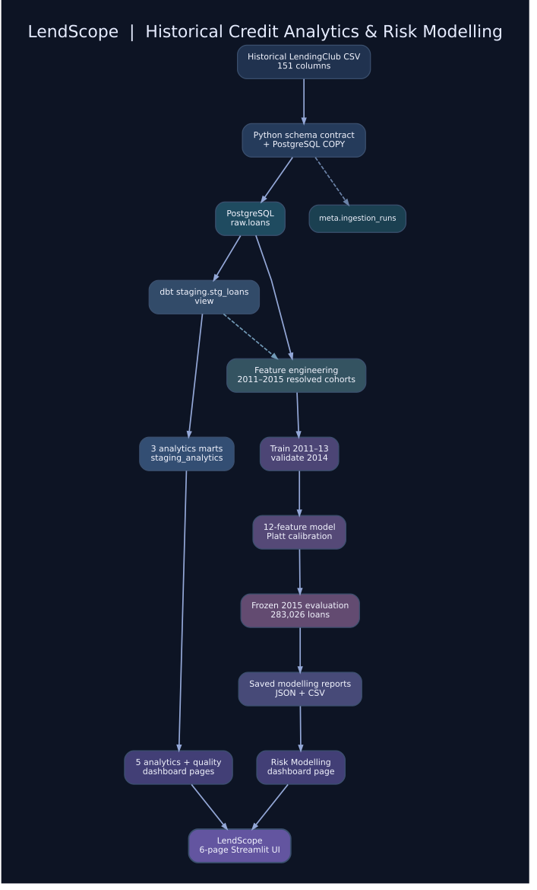
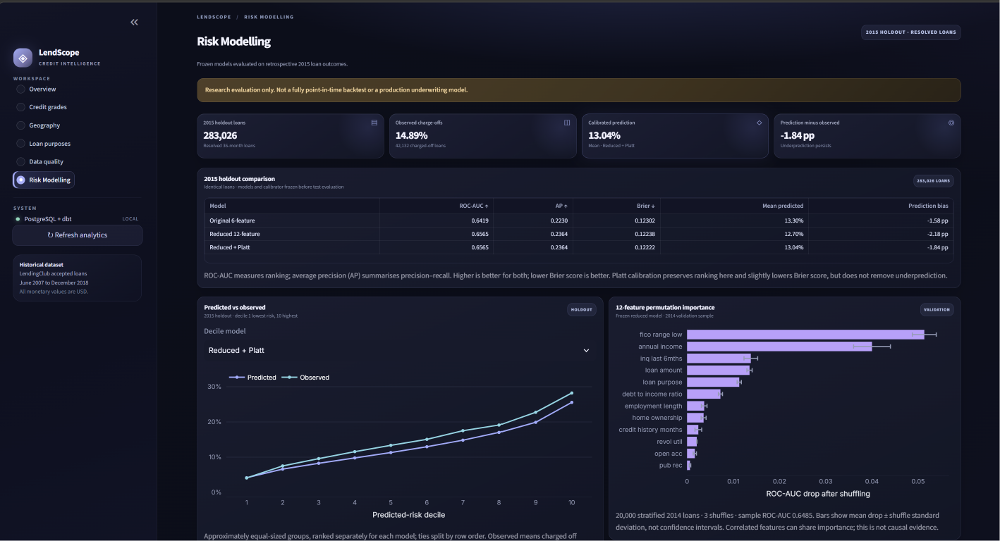
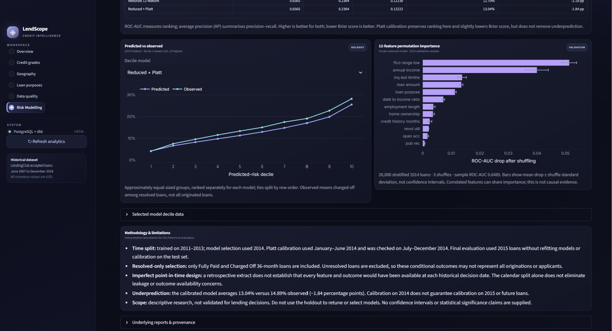

# LendScope

**Historical credit risk analytics and machine learning | Python · PostgreSQL · dbt · scikit-learn · Streamlit**

LendScope is an end to end portfolio project built around historical LendingClub accepted loan records. It combines chunked CSV ingestion, PostgreSQL data quality checks, dbt reporting models, a six page interactive dashboard, and an offline credit risk modelling workflow with chronological evaluation.

**Key results:** 2,260,668 identifiable loan records profiled · 3 analytics marts · 51 Python tests and 8 dbt tests · 283,026 resolved 2015 loans in the final model evaluation.

> **Research project, not a lending decision system.** The classifier predicts retrospective charge off among a selected population of *resolved* 36 month loans. It is not a validated probability of default for newly originated loans or a point in time production backtest.

## Architecture



[Architecture explanation and editable Mermaid diagram](docs/ARCHITECTURE.md) · [Publication checklist](docs/PUBLISHING_CHECKLIST.md) · [Automated testing notes](TESTING.md)

The platform contains two related workflows:

- **Portfolio analytics:** LendingClub CSV → Python schema validation and PostgreSQL `COPY` → `raw.loans` → dbt `staging.stg_loans` → three tables in `staging_analytics` → Streamlit dashboard.
- **Credit risk research:** curated loan cohorts → feature engineering and chronological training/validation → model comparison, feature ablation and Platt calibration → a frozen 2015 holdout evaluation → version controlled summary reports consumed by the dashboard.

The dashboard queries the **three aggregate tables** for its five portfolio/data quality pages and reads **saved JSON/CSV modelling reports** for its Risk Modelling page. It does not train models or score borrowers interactively.

## What it demonstrates

| Layer | Implementation |
| --- | --- |
| Ingestion | Validate a 151 column source schema, bulk load via PostgreSQL `COPY` to a staging table, promote to `raw.loans`, track run status in `meta.ingestion_runs` |
| Data quality | Verify source counts, loan ID uniqueness, critical fields and column count |
| SQL modelling | dbt staging view plus purpose/year, vintage/grade and state marts; reconciliation and column tests |
| Feature engineering | Numeric validation, categorical missing value handling, credit history months at origination, binary charge off target |
| Machine learning | Logistic regression baseline, histogram gradient boosting, expanded features, permutation importance, 14 to 12 feature ablation and Platt calibration |
| Evaluation | Chronological model development; 2015 final holdout, ROC AUC, average precision, Brier score, risk deciles and calibration bias |
| Presentation | Streamlit + Plotly; Overview, Credit grades, Geography, Loan purposes, Data quality and Risk Modelling |
| Testing | 51 fast synthetic data Python tests and 8 database backed dbt tests |

### Dashboard

The six navigation pages are **Overview**, **Credit grades**, **Geography**, **Loan purposes**, **Data quality**, and **Risk Modelling**. The first five require a running database and populated marts. The sixth displays frozen modelling results, risk deciles, validation feature importance and methodology notes using the committed reports in `reports/modeling/`.

The following are **actual LendScope screenshots supplied by the project author**, not generated mock-ups.





Add a real **Overview** screenshot before publication if available; the project export did not contain one.

## Data and modelling design

The raw source used for this project is named `accepted_2007_to_2018Q4.csv`. In the source specific quality checks it contains **2,260,701 rows**, including **2,260,668 records with numeric loan IDs** and 33 non loan/metadata rows. The CSV itself is **not distributed** with this repository. The ingestion and quality scripts expect this particular 151-column export; a different release may require adaptation.

The binary research cohort includes only loans with a **36-month term**, originated in **2011–2015** and a resolved status of **`Fully Paid`** (0) or **`Charged Off`** (1).

| Dataset | Origination years | Resolved loans | Charged off |
| --- | --- | ---: | ---: |
| Train | 2011–2013 | 157,993 | 19,780 |
| Validation/model selection | 2014 | 162,570 | 22,315 |
| Final holdout | 2015 | 283,026 | 42,132 |

Model selection was performed with 2014 data. For the selected **12-feature histogram gradient boosting model**, a Platt calibrator was fitted on **January–June 2014** and checked on **July–December 2014**. The model and calibrator were not refitted on the 2015 holdout. This design is *chronologically separated*, but that alone does **not** establish historically available features or resolved outcomes at each decision date.

### Final 2015 holdout results

Source: [`reports/modeling/final_test_evaluation.json`](reports/modeling/final_test_evaluation.json), recorded 2 November 2026.

| Frozen model | ROC-AUC ↑ | Average precision ↑ | Brier ↓ | Mean predicted charge-off | Bias vs. observed |
| --- | ---: | ---: | ---: | ---: | ---: |
| Original 6-feature gradient boosting | 0.6419 | 0.2230 | 0.12302 | 13.30% | −1.58 pp |
| Reduced 12-feature gradient boosting | 0.6565 | 0.2364 | 0.12238 | 12.70% | −2.18 pp |
| **Reduced + Platt calibration** | **0.6565** | **0.2364** | **0.12222** | **13.04%** | **−1.84 pp** |

The observed charge-off rate was **14.89%**. The selected model's highest risk decile had approximately **6.89×** the observed charge off rate of its lowest risk decile; the top decile captured **18.96%** of observed charge offs. Platt calibration modestly improved Brier score without changing rank based discrimination. **Underprediction remained** on the held out year.

Further results and provenance are stored in [`reports/modeling/`](reports/modeling/), including validation comparisons, deciles, ablation, robustness checks and permutation importance. **Permutation importance is predictive, not causal**, and its shuffle standard deviation is not a confidence interval.

### Limitations

- **Resolved only selection/survivorship bias:** excluding unresolved loans changes the evaluated population; rates do not represent all originations or loan applicants.
- **Not a point in time backtest:** historical outcome availability and feature availability at decision time are not fully demonstrated; temporal splitting alone does not exclude leakage.
- **Moderate discrimination:** ROC-AUC ~0.6565 is useful for a demonstrative workflow, not evidence of production underwriting suitability.
- **Calibration drift:** the selected model underpredicted 2015 charge offs by ~1.84 percentage points despite 2014 calibration.
- **No uncertainty or fairness claims:** this repository does not establish confidence intervals, statistical significance, model fairness, monitoring, regulatory compliance or real world economic value.
- **Data/version specificity:** hard coded source contract counts and SQL assumptions are tied to the particular historical LendingClub export used here.

## Getting started (Windows PowerShell)

**Requirements:** Python 3.11, Docker Desktop with Docker Compose, sufficient disk space for the original dataset/PostgreSQL, and the source CSV if running ingestion or rebuilding the models. The Python dependencies were verified in the author's Windows environment; a **clean-room installation has not yet been demonstrated**.

### A. Install Python dependencies and run unit tests (no loan data required)

From the cloned repository root:

```powershell
py -3.11 -m venv .venv
.\.venv\Scripts\Activate.ps1
python -m pip install -r requirements.txt
python -m pytest -q
```

The 51 Python tests use synthetic data, do not require Docker/PostgreSQL or the raw CSV, and do not retrain or access the final holdout. `pytest.ini` sets a local `.pytest_tmp` base directory to avoid Windows temporary-folder permissions issues. Refer to [`TESTING.md`](TESTING.md) for test scope.

### B. Configure PostgreSQL for a fresh local environment

**Before public release:** replace the tracked `docker-compose.yml` hardcoded development password with environment variable substitution, and update `.env.example` consistently. Review the replacement examples in the separately supplied publication pack. **Do not blindly replace settings on an existing initialized PostgreSQL volume:** changing a container's `POSTGRES_PASSWORD` variable does not change an existing database user's password.

For a **fresh installation using the reviewed, environment driven Compose configuration**:

```powershell
Copy-Item .env.example .env
notepad .env
# Replace the POSTGRES_PASSWORD placeholder with a private value, then save.
docker compose up -d
python .\src\ingestion\database.py
```

Use matching values across `.env`, Compose and dbt. The application expects `POSTGRES_HOST`, `POSTGRES_PORT`, `POSTGRES_DB`, `POSTGRES_USER` and `POSTGRES_PASSWORD`. `.env` is Git-ignored. The sample Compose configuration binds PostgreSQL to **127.0.0.1:5433** rather than all network interfaces.

Set up dbt's local profile separately. Its project name and profile key are both `credit_risk_analytics`, and with target schema `staging` the mart tables materialize in `staging_analytics`:

```powershell
New-Item -ItemType Directory -Path "$HOME\.dbt" -Force | Out-Null
# If profiles.yml exists, merge the entry rather than overwriting other profiles.
# Otherwise, copy docs/dbt_profiles.example.yml to $HOME\.dbt\profiles.yml.
$env:CREDIT_RISK_DB_PASSWORD = (python -c "from src.ingestion.database import get_engine; print(get_engine().url.password)").Trim()
dbt debug --project-dir .\dbt
```

The sample profile uses the `CREDIT_RISK_DB_PASSWORD` environment variable to avoid writing the password into `profiles.yml`. Set it in each new PowerShell session that runs dbt. Do not echo its value or commit your local profile.

### C. Load the historical source and build the analytics marts

Only proceed when you have the **matching original CSV** in `data/raw/accepted_2007_to_2018Q4.csv` and a working database connection. Importing the full dataset uses significant time/disk space and replaces `raw.loans` through a validated staging table promotion.

```powershell
python .\src\ingestion\init_db.py
python .\src\ingestion\load_raw_loans.py
python -m src.quality.check_raw_loans
dbt run --project-dir .\dbt
dbt test --project-dir .\dbt
```

The dbt project builds **one staging view and three materialized marts** and provides **eight tests** (five column tests and three SQL reconciliation assertions). The dataset source contract is strict: if its columns or expected counts do not match, review the data rather than disabling the checks.

### D. Run the six page dashboard

```powershell
python -m streamlit run .\dashboard\app.py --server.address 127.0.0.1
```

Open `http://127.0.0.1:8501` (Streamlit's default port). The first five pages query database marts. **Risk Modelling** reads the committed report files and can display them independently of a database connection. A live database is still required for the other pages.

### E. Optional: reproduce model training and final holdout evaluation

**This is not part of the quickstart.** It requires the matching historical dataset, populated database, disk space and time. It writes generated CSVs/models into Git-ignored `data/processed/` and can overwrite existing local outputs. Preserve existing artifacts before rerunning. Keep the 2015 holdout untouched during feature development and selection.

```powershell
python -m src.modeling.build_dataset
python -m src.modeling.build_expanded_dataset
python -m src.modeling.train_baseline
python -m src.modeling.train_gradient_boosting
python -m src.modeling.train_expanded_model
python -m src.modeling.feature_importance
python -m src.modeling.feature_ablation
python -m src.modeling.calibrate_model
# Only after the model/calibrator have been frozen:
python -m src.modeling.build_expanded_test
python -m src.modeling.evaluate_final_test
```

Scripts such as `evaluate_validation.py`, `compare_risk_deciles.py` and `outlier_robustness.py` provide additional validation analyses. The final-holdout script writes `reports/modeling/final_test_evaluation.json` and `final_test_deciles.csv`; **do not repeat evaluation to tune hyperparameters or claim an additional independent holdout**.

## Repository layout

```text
credit-risk-data-platform/
├── dashboard/          # Streamlit UI and CSS
├── data/raw/           # Local historical input; actual data ignored by Git
├── data/processed/     # Local modelling datasets and .joblib artifacts; ignored
├── dbt/                # dbt staging view, marts and reconciliation tests
├── docs/               # Architecture and publication guidance (this pack)
├── reports/modeling/   # Committed aggregate model reports, not model binaries
├── sql/                # Ad hoc modelling/data audit SQL
├── src/ingestion/      # Contracts, bulk load, metadata, connection setup
├── src/modeling/       # Feature engineering, training, validation, calibration
├── src/quality/        # Source level data checks
├── tests/              # Synthetic pytest suite
├── docker-compose.yml # Local PostgreSQL 17 service (review password first)
├── requirements.txt   # Pinned top level Python packages
└── TESTING.md          # Scope and limits of Python tests
```

## Publication and data handling

The committed repository omits the original CSV and `.joblib` files. Do not publish private `.env`, `.streamlit` secrets, personal dbt `profiles.yml`, database volumes, backup dashboards or generated datasets. The source ZIP used for this documentation contains a **hardcoded development password in `docker-compose.yml`**, so use the publication checklist and fix that configuration before making the repository public. A filename scan alone is not a full secret scan of every past commit.

The dataset is historical third party data. Confirm the original source attribution, licence and permitted redistribution before linking to or sharing it. For the methodology, see the saved validation/evaluation reports rather than assuming that all metrics apply to newly issued loans.

**Status:** Built and evaluated as a local portfolio project; Risk Modelling screenshots are included, but an Overview screenshot, fresh-machine reproduction, public configuration hygiene and GitHub publication remain to be completed.
