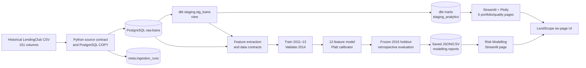

# LendScope architecture

The analytics and modelling branches share the historical LendingClub loan source but serve different objectives. This is an **offline batch application**, not a real-time prediction API.

## Data flow

**Notes:** dbt's `stg_loans` is a view in `staging`. The marts explicitly request a custom schema `analytics`, which dbt names `staging_analytics` under the documented target-schema configuration. The Risk Modelling page reads saved reports and does not perform model inference. `meta.ingestion_runs` records the import lifecycle; the data quality page also reads raw-source quality information from PostgreSQL.

## Component responsibilities

| Component | Input | Output/side effect |
| --- | --- | --- |
| `src/ingestion/source_contract.py` | `data/raw/accepted_2007_to_2018Q4.csv` | Validates 151-column header and required fields |
| `src/ingestion/load_raw_loans.py` | Validated CSV | Batch bulk load and staged promotion to `raw.loans`; audit records in `meta.ingestion_runs` |
| `src/quality/check_raw_loans.py` | `raw.loans` | Source-volume, uniqueness and critical-field checks |
| `dbt/models/staging/stg_loans.sql` | `raw.loans` | `staging.stg_loans` view of typed loan fields |
| `dbt/models/marts/` | `stg_loans` | Tables by state, loan purpose/year and vintage/grade |
| `src/modeling/build_*.py` | Raw/staged loans | Local cohort CSVs; strict row/target counts |
| `src/modeling/train_*.py` and `feature_ablation.py` | Train/validation CSVs | Fitted local `.joblib` models, validation reports |
| `src/modeling/calibrate_model.py` | Frozen reduced model and 2014 data | Local Platt calibrator and calibration report |
| `src/modeling/evaluate_final_test.py` | Frozen model/calibrator and matching 2015 cohorts | Holdout JSON report and risk deciles |
| `dashboard/app.py` | dbt marts, ingestion metadata, modelling reports | Six dashboard pages; no database writes |
| `tests/` and `dbt/tests/` | Synthetic fixtures / populated marts | 51 Python tests / 8 dbt checks in the verified environment |

## Boundaries and non-goals

- The portfolio marts describe **historical loan records**, not a live credit portfolio.
- Outcome-specific rates are calculated on **resolved loans**, not all loans.
- The 2015 data was reserved for frozen evaluation; no point-in-time leakage proof exists.
- No inference endpoint, authentication layer, deployed API, batch risk-scoring job, CI pipeline, fairness assessment or production monitoring is provided in the exported code.
- The source CSV and local trained-model files are intentionally absent from Git.
